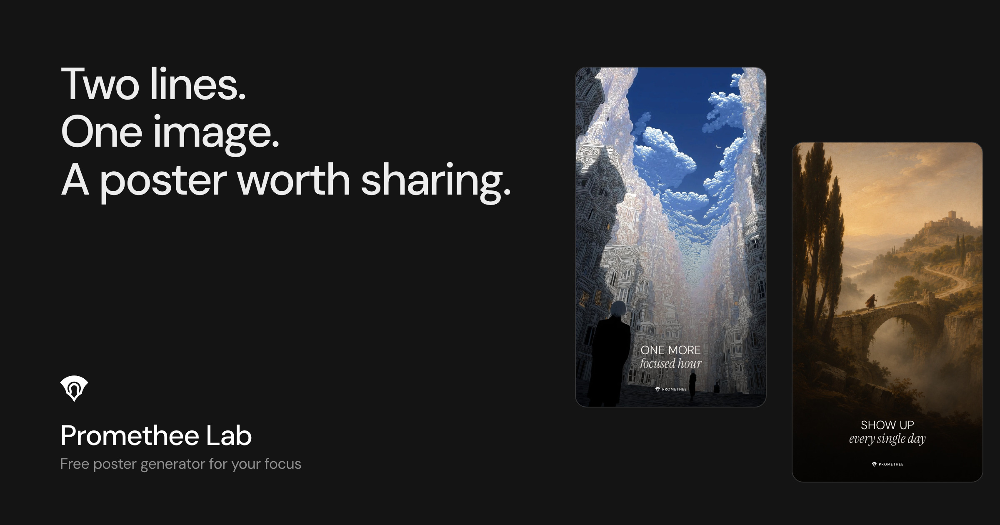

# Promethee Lab



[Promethee Lab](https://promethee-lab.pages.dev/) is a free tool for making posters and wallpapers in the Promethee style. Built for the community.

- Pick a background from the gallery, upload your own, or paste an image URL.
- Add your own words and adjust the text size, placement, and image crop.
- Make a story, a portrait or square post, or a desktop wallpaper.
- Export as PNG, JPG, or WebP.

## Local development

```bash
git clone https://github.com/y2-znt/promethee-lab.git
cd promethee-lab
python3 -m http.server 8080
```

Open [localhost:8080](http://localhost:8080). The project runs on plain HTML, CSS, and JavaScript with no build step.

## Contributing

Found a bug or have an idea? [Open an issue](https://github.com/y2-znt/promethee-lab/issues). Pull requests are welcome.
